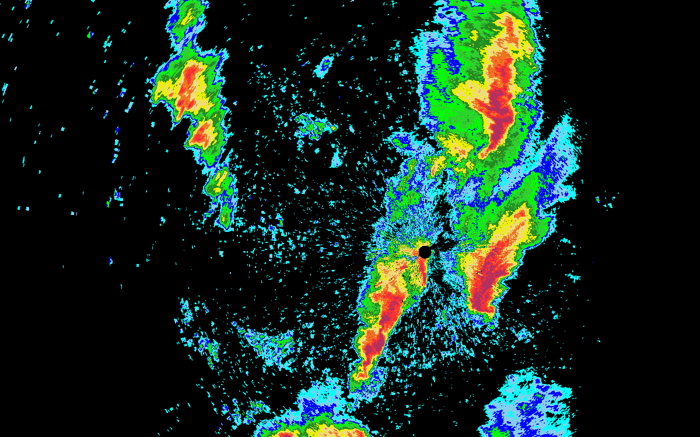
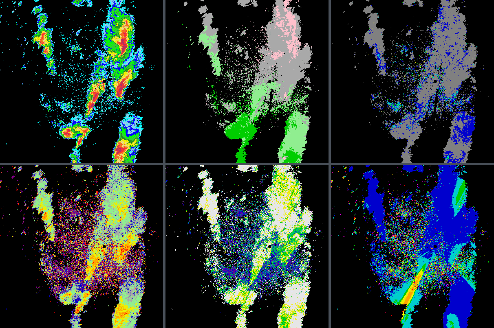
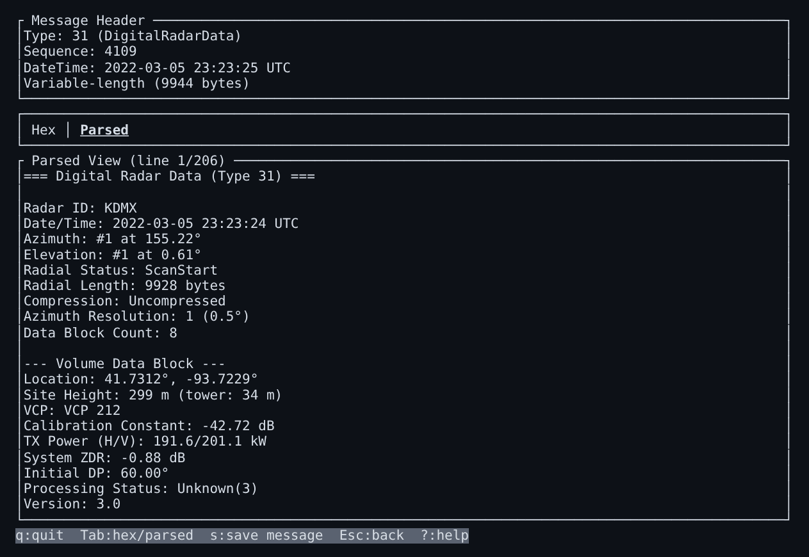

# nexrad

[](https://crates.io/crates/nexrad)
[](https://docs.rs/nexrad)
[](https://github.com/danielway/nexrad/actions/workflows/ci.yml)
[](#installation)
[](LICENSE)

Rust crates for loading, downloading, decoding, processing and rendering NEXRAD WSR-88D weather radar data.



*Lowest-tilt reflectivity from KDMX (Des Moines, Iowa), 5 March 2022 23:23 UTC, drawn by `nexrad-render`.*

## Scope

The nexrad crates read NEXRAD Level II data in the Archive II format (ICD 2620010) and the RDA/RPG messages it carries
(ICD 2620002), from WSR-88D and TDWR radars. They read the whole archive, including volumes with legacy message 1
radials, volumes from before 2008 that carry no VCP message, and gzip-compressed volumes back to 1991. `_MDM` objects
(Model Data, message type 29) and archive tarballs are not read, and Level III products are out of scope.

## Crates

| Crate | What it does |
|-------|--------------|
| [`nexrad`](nexrad) [](https://crates.io/crates/nexrad) | The entry point: loading, downloading and rendering in one dependency, with the other crates re-exported. |
| [`nexrad-model`](nexrad-model) [](https://crates.io/crates/nexrad-model) | Scan, sweep and radial types, documented for readers who don't know the Archive II format. |
| [`nexrad-decode`](nexrad-decode) [](https://crates.io/crates/nexrad-decode) | Decodes RDA/RPG messages as laid out in NOAA's ICD 2620002AA. |
| [`nexrad-data`](nexrad-data) [](https://crates.io/crates/nexrad-data) | Archive II files, decompression, and downloads from NOAA's buckets on AWS. |
| [`nexrad-process`](nexrad-process) [](https://crates.io/crates/nexrad-process) | Filters and derived products such as composite reflectivity. |
| [`nexrad-render`](nexrad-render) [](https://crates.io/crates/nexrad-render) | Renders fields to RGBA images and PNG files. |
| [`nexrad-inspector`](nexrad-inspector) | A terminal tool for browsing the records and messages in a volume file. Not published; run it from the repository. |

[docs/architecture.md](docs/architecture.md) shows how the crates depend on each other.



*The lowest tilt of six products from the same volume, each drawn with `nexrad-render`'s `default_scale`. Top row:
reflectivity, velocity, spectrum width. Bottom row: differential reflectivity, correlation coefficient, differential
phase.*

### Inspector



`nexrad-inspector` opens local volume files or downloads them from AWS, decompresses LDM records, and shows each message
as hex or as decoded fields:

```bash
cargo run -p nexrad-inspector
```

## Getting Started

### Installation

Add `nexrad` to your `Cargo.toml`:

```toml
[dependencies]
nexrad = "1.0"
```

The default features cover local file loading, AWS downloads and real-time streaming, and rendering. Processing
(`process`), serialization (`serde`), parallel decoding (`parallel`), the faster vendored bzip2 decoder
(`recast-bzip2`) and `image` crate interop (`image`) are opt-in, and `full` enables every feature except `image` and
`recast-bzip2`.

**Common configurations:**

```toml
# Minimal - local file processing only (no rendering, no networking)
nexrad = { version = "1.0", default-features = false, features = ["data"] }

# AWS S3 downloads without rendering
nexrad = { version = "1.0", default-features = false, features = ["aws-rustls"] }
tokio = { version = "1", features = ["full"] }

# Every feature except `image` (native only)
nexrad = { version = "1.0", features = ["full"] }
```

**Minimum supported Rust version:** 1.88. The MSRV is only raised in minor releases, never in patch releases.

### Quick Example: Load and Inspect a Scan

```rust,no_run
fn main() -> nexrad::Result<()> {
    // Load from a local Archive II file
    let scan = nexrad::load_file("KTLX20230520_201643_V06.ar2v")?;

    println!("{}", scan.coverage_pattern_number());
    println!("Sweeps: {}", scan.sweeps().len());

    // Iterate through sweeps and radials
    for sweep in scan.sweeps() {
        println!("Elevation {}: {} radials",
            sweep.elevation_number(),
            sweep.radials().len());

        for radial in sweep.radials() {
            if let Some(reflectivity) = radial.reflectivity() {
                println!("  {} reflectivity gates", reflectivity.gate_count());
            }
        }
    }

    Ok(())
}
```

### Download from AWS

With the `aws` feature enabled, download radar data directly from the NEXRAD archive:

```rust,ignore
use nexrad::chrono::NaiveDate;

#[tokio::main]
async fn main() -> nexrad::Result<()> {
    let date = NaiveDate::from_ymd_opt(2023, 5, 20).unwrap();

    // List available scans
    let scans = nexrad::list_scans("KTLX", date).await?;
    println!("Found {} scans", scans.len());

    // Download the last scan of that day
    if let Some(id) = scans.last() {
        let scan = nexrad::download(id).await?;
        println!("{}", scan.coverage_pattern_number());
    }

    // Download the newest scan available now
    let scan = nexrad::download_latest("KTLX").await?;
    println!("{}", scan.coverage_pattern_number());

    Ok(())
}
```

### Render Radar Images

With the `render` feature, create PNG images from radar data:

```rust,ignore
use nexrad::model::data::Product;
use nexrad::render::{default_scale, render_sweep, RenderOptions};

fn main() -> nexrad::Result<()> {
    let scan = nexrad::load_file("KTLX20230520_201643_V06.ar2v")?;
    let sweep = scan.sweeps().first().unwrap();
    let field = sweep.field(Product::Reflectivity).unwrap();

    let options = RenderOptions::new(1024, 1024);
    let color_scale = default_scale(Product::Reflectivity);

    let result = render_sweep(&field, &color_scale, &options)?;
    result.save_png("reflectivity.png")?;
    Ok(())
}
```

### Feature Reference

The [`nexrad` crate README](nexrad/README.md#features) lists every feature, what each one implies, and the TLS
backend options.

### WASM Support

Every feature except `parallel` (which needs threads) builds for `wasm32-unknown-unknown`. On `wasm32`, `aws` uses the
JavaScript `fetch` API and needs no TLS feature:

```toml
nexrad = { version = "1.0", default-features = false, features = [
    "data", "render", "process", "aws", "serde", "chrono",
] }
```

Real-time streaming (`nexrad::stream`, `nexrad::stream_scans`) is part of `aws` and works on WASM: it takes a caller-supplied sleep
function instead of depending on a specific async runtime.

### Examples

Run the included examples:

```bash
# Decode and summarize a volume file
cargo run -p nexrad --example decode_summary -- path/to/volume.ar2v

# Download latest data from AWS
cargo run -p nexrad --example download_latest -- KTLX

# Render reflectivity image
cargo run -p nexrad --example render_reflectivity -- path/to/volume.ar2v output.png

# Filter a sweep, compute composite reflectivity, and render both
cargo run -p nexrad --example processing_pipeline --features process -- path/to/volume.ar2v

# Render every product and processing step for a full scan into renders/
cargo run -p nexrad --example showcase --features process --release
```

### Lower-Level APIs

Each crate in the [Crates](#crates) table can be used on its own. See each crate's documentation for its API, and
[docs/architecture.md](docs/architecture.md) for how the crates fit together and the API stability rules they follow.

### Changelogs

Each library crate records its changes in its own CHANGELOG:
[`nexrad`](nexrad/CHANGELOG.md), [`nexrad-model`](nexrad-model/CHANGELOG.md),
[`nexrad-decode`](nexrad-decode/CHANGELOG.md), [`nexrad-data`](nexrad-data/CHANGELOG.md),
[`nexrad-process`](nexrad-process/CHANGELOG.md) and [`nexrad-render`](nexrad-render/CHANGELOG.md).

Upgrading from a 0.x release or a `1.0.0-rc` release candidate? [Migrating to 1.0](docs/migrating-to-1.0.md) walks
through the changes crate by crate, with before-and-after examples.

## Maintaining the Radar Site Registry

The checked-in NEXRAD site registry is audited against NOAA's radar site catalog.
The normal workspace test suite checks the registry against a checked-in snapshot
offline, and a weekly workflow compares that snapshot with NOAA's current data.
To fetch NOAA data and refresh the snapshot explicitly, run:

```bash
cargo run -p xtask -- update-radar-sites
```

See [Radar site registry maintenance](docs/radar-site-registry.md) for the audit
policy, failure behavior, and complete update workflow.

## README Images

The images under [docs/images](docs/images) are rendered from one public KDMX volume through the crates' own API.
To regenerate them, run:

```bash
cargo run -p xtask -- readme-images
```

The inspector screenshot is captured by hand. Crate READMEs link the images at their crate's release tag (for example
`nexrad-render@1.0.0`), so the README on crates.io keeps the image it was published with; see
[Releasing](docs/releasing.md#readme-images).

## Acknowledgements

I consulted the following resources when developing this library:

NOAA NCEI, NEXRAD System and Product Description with Access Information:
https://www.ncei.noaa.gov/products/radar/next-generation-weather-radar

NOAA NWS, Radar Operations Center, NEXRAD WSR-88D Level II Data Information:
https://www.roc.noaa.gov/wsr88d/level_ii/level2info.aspx

NOAA NWS, Radar Operations Center, NEXRAD WSR-88D Interface Control Documents:
https://www.roc.noaa.gov/wsr88d/BuildInfo/Files.aspx

NASA TRMM, Radar Software Library:
https://trmm-fc.gsfc.nasa.gov/trmm_gv/software/rsl/

Brian Wigginton, a Go implementation of NEXRAD Level II decoding:
https://github.com/bwiggs/go-nexrad
